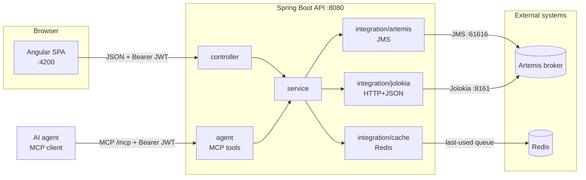

# Message Inspector — backend

[](https://github.com/Jason-McKay/message-inspector/actions/workflows/ci.yml)
[](https://github.com/Jason-McKay/message-inspector/actions/workflows/security.yml)

A browser-based tool for inspecting **ActiveMQ Artemis JMS queues**: list queues, browse
the messages on a queue, view a message, and resend / delete / move it to a dead-letter
queue. This repository is the **Spring Boot 4.1 / Java 21** API; the Angular UI lives in a
[separate repository](https://github.com/Jason-McKay/message-inspector-ui).

> The UI, with screenshots, is documented in the
> [frontend repo](https://github.com/Jason-McKay/message-inspector-ui).

## Architecture

The app needs two different things from the broker, and gets them over two different
transports — a deliberate split ([ADR 0001](docs/adr/0001-two-broker-access-paths.md)):

- **Message-level operations** (browse, get-by-id, resend, delete, move-to-DLQ) over
  **JMS**, because those are message-addressed operations JMS does natively.
- **Queue metadata** (which queues exist) over the broker's **Jolokia** HTTP bridge,
  because JMS cannot enumerate destinations.



Packages are named by **role**, not by a template — `integration/{artemis,jolokia,cache}`
is the external-system boundary, and there is deliberately no `domain`/`mapper`/`repository`
package ([ADR 0004](docs/adr/0004-layered-package-structure.md)). `agent/` is a second
entry point beside `controller/`: the [MCP tools](#mcp-server-ai-agents), which call the same
services. Every package carries a `package-info.java` explaining what it is for.

HTTP JSON is **Jackson 3** (Boot 4's default), with
`spring.jackson.use-jackson2-defaults=true` so response documents keep the Jackson 2
shape the Angular client already parses ([ADR 0008](docs/adr/0008-spring-boot-4-1.md)).
The routes, status codes, and `ApiResponse` body are unchanged.

## Running it

### Quick start — one command (Docker)

The fastest way to run the whole backend. This repo's `compose.yaml` builds the app image
and wires it to its own Artemis + Redis (self-contained — it does **not** use the shared
`infrastructure/` stack):

```bash
docker compose up --build
```

App on `:8080` (Swagger at `/api/swagger-ui.html`), Artemis console on `:8161`, all
credentials `admin`/`admin`. The app reaches its siblings by service name via env overrides
in the compose file.

### Dev loop — run from source

Needs **JDK 21** and **Docker** (for the broker and Redis).

1. **Infrastructure** — start the shared dev stack (Artemis + Redis) from the sibling
   `infrastructure/` directory:
   ```powershell
   cd ..\infrastructure; .\up.ps1; bash ./test-containers.sh
   ```
   `up.ps1` loads the MySQL and Redis passwords from the local secret store before running
   `docker compose up -d` (plain `docker compose` in that folder refuses to start without them).
   Artemis: JMS on `:61616`, console/Jolokia on `:8161`. Redis on `:6379`, password required.
   Only Artemis still uses `admin`/`admin`.

2. **Backend** - load `REDIS_PASSWORD` into the shell first, or the app cannot authenticate to
   the shared Redis (it maps to `spring.data.redis.password`; unset means no AUTH, which is right
   only for the self-contained compose stack above). Process scope only, never a saved variable:
   ```powershell
   Import-Module ..\life-api\scripts\VantageSecrets.psm1; Import-VantageSecrets -Name REDIS_PASSWORD
   .\mvnw.cmd spring-boot:run    # ./mvnw spring-boot:run in bash, with REDIS_PASSWORD exported
   ```
   Boots on `:8080`. Log in with `jason`/`jason` (USER) or `admin`/`admin` (ADMIN).

3. **Frontend** — see the [UI repo](https://github.com/Jason-McKay/message-inspector-ui)
   (`npm start`, needs Node 24.18.0).

**API docs (dev only):** Swagger UI at `http://localhost:8080/api/swagger-ui.html`,
OpenAPI JSON at `/api/api-docs`. These are served **only under the `dev` profile** (the
default); any other `SPRING_PROFILES_ACTIVE` returns 404
([ADR 0006](docs/adr/0006-dependency-maintenance-workflow.md) explains why).

> ⚠️ **Dev secrets are committed on purpose.** `application.properties` carries a throwaway
> JWT signing secret and dev passwords so a fresh clone boots with no setup. They are
> env-overridable (`MESSAGE_INSPECTOR_JWT_SECRET`, `..._ADMIN_PASSWORD`,
> `..._USER_PASSWORD`) and **must be overridden before any real deployment.**

## API

All routes require a bearer token except `POST /api/auth/login`. Destructive operations
require the **ADMIN** role.

| Method | Path | Purpose |
|---|---|---|
| `POST` | `/api/auth/login` | Exchange credentials for a JWT |
| `GET` | `/api/messages/queue/{queue}` | List messages on a queue |
| `GET` | `/api/messages/queue/{queue}/message/{id}` | View one message |
| `POST` | `/api/messages/queue/{queue}/message/{id}/resend` | Republish a message |
| `DELETE` | `/api/messages/queue/{queue}/message/{id}` | Delete a message *(ADMIN)* |
| `POST` | `/api/messages/queue/{queue}/message/{id}/move-to-dlq` | Move to DLQ *(ADMIN)* |
| `GET` | `/api/queues/artemis-jolokia/names` | List queue names |
| `GET`/`POST` | `/api/queues/last-used` | Read/write the caller's last-used queue |

**The response contract — important.** The mutating endpoints return **HTTP 200 even when
the operation failed**, with the real outcome in the body:

```json
{ "success": false, "message": "Message not found." }
```

A 200 is *not* proof of success — the body's `success` flag is. Transport and server faults
are separate and truthful: **400** for a rejected message ID, **502** when the broker (JMS
or Jolokia) is unavailable, **500** otherwise, all with the same body shape.

## MCP server (AI agents)

The same operations are available to AI agents as
[Model Context Protocol](https://modelcontextprotocol.io) tools, at `http://localhost:8080/mcp`
(Streamable HTTP, stateless). They run under the same JWT and the same ADMIN rule as the REST
API, and they call the same services. [ADR 0009](docs/adr/0009-mcp-server.md) explains the
design, and [`docs/mcp-demo.md`](docs/mcp-demo.md) is a recorded agent session.

**Run it.** MCP is on whenever the app is, with either `docker compose up --build` or
`./mvnw spring-boot:run`. A request without a token gets a 401.

**Connect Claude Code.** Log in, then register the server with the token as a header:

```bash
TOKEN=$(curl -s -X POST http://localhost:8080/api/auth/login \
  -H 'Content-Type: application/json' -d '{"username":"admin","password":"admin"}' \
  | sed -E 's/.*"token":"([^"]+)".*/\1/')

claude mcp add --transport http message-inspector http://localhost:8080/mcp \
  --header "Authorization: Bearer $TOKEN"
```

Log in as `jason`/`jason` instead for a read-only agent.

- **Tokens expire after an hour.** Then run `claude mcp remove message-inspector`, log in
  again and re-add the server.
- **Claude Code stores the header in its local config in plain text**, so remove the server
  when you are done.

Any other MCP client works the same way, e.g.
`npx @modelcontextprotocol/inspector --cli http://localhost:8080/mcp --transport http --header "Authorization: Bearer $TOKEN" --method tools/list`.

| Tool | Does | Role | Hints |
|---|---|---|---|
| `list_queues` | Queue names on the broker | any | read-only |
| `browse_messages` | One page of a queue: default 20, max 100, payloads cut to 500 chars | any | read-only |
| `get_message` | One message, payload cut to 8000 chars | any | read-only |
| `resend_message` | Publish a copy back onto the queue | **ADMIN** | not idempotent |
| `delete_message` | Remove a message permanently | **ADMIN** | destructive |
| `move_message_to_dlq` | Move a message to the dead-letter queue | **ADMIN** | destructive |

**Resend is ADMIN-only here, although the REST API lets a USER resend.** Each resend adds a
copy, and an agent may retry.

**Guardrails.**
- An unknown queue name is refused before any broker call, because Artemis would
  auto-create it.
- A malformed message ID is refused without being echoed back.
- Every admin tool call, allowed or denied, writes one audit line to stdout:
  `AUDIT agent-tool=... user=... queue=... messageId=... outcome=...`.

**Example prompts:**

- *"What queues are on the broker? Show me the first five messages on DLQ."*
- *"Find order A-1002 on the orders queue and show me its properties."*
- *"Move every message on orders with a negative quantity to the DLQ."* (ADMIN)
- *"Resend message ID:... on orders, once."* (ADMIN)

**Turn it off** with `SPRING_AI_MCP_SERVER_ENABLED=false`. `/mcp` then returns 404 to an
authenticated caller and 401 to everyone else. The REST API is unaffected.

## Testing

```bash
./mvnw test      # unit + @WebMvcTest slices (fast, no broker)
./mvnw verify    # the above + MessageServiceIT and McpServerIT against a real Artemis container
```

`./mvnw test` needs no Artemis broker, but it **does need Docker** — a couple of tests spin
up Redis via Testcontainers. `./mvnw verify` additionally runs `MessageServiceIT` and
`McpServerIT`, each of which spins up its own Artemis via Testcontainers. `McpServerIT`
drives the tools through a real MCP client over HTTP, with real JWTs for both roles. Note that **no test opens a JMS connection in
the unit suite** — a green `test` run says nothing about broker compatibility, so
client/broker version changes are verified with a documented manual pass (see `CLAUDE.md`).

**CI:** `./mvnw test` runs on every push/PR via
[`.github/workflows/ci.yml`](.github/workflows/ci.yml); the OWASP gate runs nightly and
on demand via [`.github/workflows/security.yml`](.github/workflows/security.yml)
([ADR 0007](docs/adr/0007-ci-cd-pipeline.md)).

## Security & dependencies

- **Auth:** stateless JWT bearer, in-memory users, role-gated destructive endpoints
  ([ADR 0005](docs/adr/0005-jwt-bearer-over-cookie-session.md)).
- **CVEs:** an OWASP Dependency-Check pass took the project from **133 → 12** unique CVEs
  (−91%), **5 → 0** criticals. It is a real build gate (`failBuildOnCVSS=7`) that runs
  locally on demand and **nightly in CI**
  ([ADR 0006](docs/adr/0006-dependency-maintenance-workflow.md),
  [ADR 0007](docs/adr/0007-ci-cd-pipeline.md)).

## Design decisions

The non-obvious choices are written up as [Architecture Decision Records](docs/adr/) — the
two-transport split, why Redis over `localStorage`, the layered structure, the auth model,
the dependency-maintenance workflow, the move to Spring Boot 4.1, and the MCP server.

## Known gaps

Honest and deliberately deferred:

- **Users are in-memory.** No database, no self-service; a real user store is the first
  thing that would bring a DB (and a `domain` package) into the app.
- **No refresh tokens.** A token expires and you log in again. For an MCP client that means
  re-adding the header every hour. The server advertises no authorization server, so a
  client cannot fetch a token itself.
- **Browsing reads the whole queue.** The REST browse returns every message; MCP paging trims
  the response, not the broker read. A non-text message on a queue fails the whole browse.
