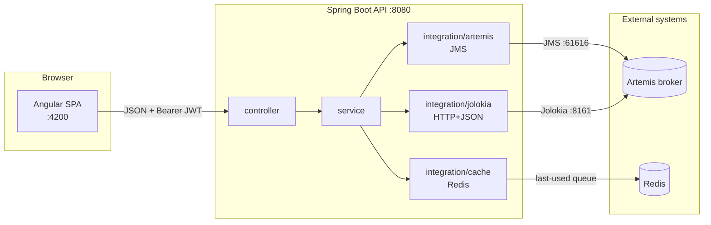

# Message Inspector — backend

A browser-based tool for inspecting **ActiveMQ Artemis JMS queues**: list queues, browse
the messages on a queue, view a message, and resend / delete / move it to a dead-letter
queue. This repository is the **Spring Boot 3.5 / Java 21** API; the Angular UI lives in a
[separate repository](https://github.com/Jason-McKay/message-inspector-ui).

> The UI, with screenshots, is documented in the
> [frontend repo](https://github.com/Jason-McKay/message-inspector-ui).

## Architecture

The app needs two different things from the broker, and gets them over two different
transports — a deliberate split ([ADR 0001](docs/adr/0001-two-broker-access-paths.md)):

- **Message-level operations** (browse, get-by-id, resend, delete, move-to-DLQ) over
  **JMS**, because those are message-addressed operations JMS does natively.
- **Queue metadata** (which queues exist) over the broker's **Jolokia** HTTP bridge,
  because JMS cannot enumerate destinations.



Packages are named by **role**, not by a template — `integration/{artemis,jolokia,cache}`
is the external-system boundary, and there is deliberately no `domain`/`mapper`/`repository`
package ([ADR 0004](docs/adr/0004-layered-package-structure.md)). Every package carries a
`package-info.java` explaining what it is for.

## Running it

Needs **JDK 21** and **Docker** (for the broker and Redis).

1. **Infrastructure** — start the shared dev stack (Artemis + Redis) from the sibling
   `infrastructure/` directory:
   ```bash
   cd ../infrastructure && docker compose up -d && ./test-containers.sh
   ```
   Artemis: JMS on `:61616`, console/Jolokia on `:8161`. Redis on `:6379`. All dev
   credentials are `admin`/`admin`.

2. **Backend**:
   ```bash
   ./mvnw spring-boot:run        # .\mvnw.cmd on PowerShell
   ```
   Boots on `:8080`. Log in with `jason`/`jason` (USER) or `admin`/`admin` (ADMIN).

3. **Frontend** — see the [UI repo](https://github.com/Jason-McKay/message-inspector-ui)
   (`npm start`, needs Node 20).

**API docs (dev only):** Swagger UI at `http://localhost:8080/api/swagger-ui.html`,
OpenAPI JSON at `/api/api-docs`. These are served **only under the `dev` profile** (the
default); any other `SPRING_PROFILES_ACTIVE` returns 404
([ADR 0006](docs/adr/0006-dependency-maintenance-workflow.md) explains why).

> ⚠️ **Dev secrets are committed on purpose.** `application.properties` carries a throwaway
> JWT signing secret and dev passwords so a fresh clone boots with no setup. They are
> env-overridable (`MESSAGE_INSPECTOR_JWT_SECRET`, `..._ADMIN_PASSWORD`,
> `..._USER_PASSWORD`) and **must be overridden before any real deployment.**

## API

All routes require a bearer token except `POST /api/auth/login`. Destructive operations
require the **ADMIN** role.

| Method | Path | Purpose |
|---|---|---|
| `POST` | `/api/auth/login` | Exchange credentials for a JWT |
| `GET` | `/api/messages/queue/{queue}` | List messages on a queue |
| `GET` | `/api/messages/queue/{queue}/message/{id}` | View one message |
| `POST` | `/api/messages/queue/{queue}/message/{id}/resend` | Republish a message |
| `DELETE` | `/api/messages/queue/{queue}/message/{id}` | Delete a message *(ADMIN)* |
| `POST` | `/api/messages/queue/{queue}/message/{id}/move-to-dlq` | Move to DLQ *(ADMIN)* |
| `GET` | `/api/queues/artemis-jolokia/names` | List queue names |
| `GET`/`POST` | `/api/queues/last-used` | Read/write the caller's last-used queue |

**The response contract — important.** The mutating endpoints return **HTTP 200 even when
the operation failed**, with the real outcome in the body:

```json
{ "success": false, "message": "Message not found." }
```

A 200 is *not* proof of success — the body's `success` flag is. Transport and server faults
are separate and truthful: **400** for a rejected message ID, **502** when the broker (JMS
or Jolokia) is unavailable, **500** otherwise, all with the same body shape.

## Testing

```bash
./mvnw test      # unit + @WebMvcTest slices (fast, no broker)
./mvnw verify    # the above + MessageServiceIT against a real Artemis container
```

`./mvnw test` is broker-free by design. `./mvnw verify` runs `MessageServiceIT`, which
spins up its own Artemis via Testcontainers. Note that **no test opens a JMS connection in
the unit suite** — a green `test` run says nothing about broker compatibility, so
client/broker version changes are verified with a documented manual pass (see `CLAUDE.md`).

## Security & dependencies

- **Auth:** stateless JWT bearer, in-memory users, role-gated destructive endpoints
  ([ADR 0005](docs/adr/0005-jwt-bearer-over-cookie-session.md)).
- **CVEs:** an OWASP Dependency-Check pass took the project from **133 → 12** unique CVEs
  (−91%), **5 → 0** criticals. The scan is a one-command standing gate
  ([ADR 0006](docs/adr/0006-dependency-maintenance-workflow.md)).

## Design decisions

The non-obvious choices are written up as [Architecture Decision Records](docs/adr/) — the
two-transport split, why Redis over `localStorage`, the layered structure, the auth model,
and the dependency-maintenance workflow.

## Known gaps

Honest and deliberately deferred:

- **Users are in-memory.** No database, no self-service; a real user store is the first
  thing that would bring a DB (and a `domain` package) into the app.
- **No refresh tokens.** A token expires and you log in again.
